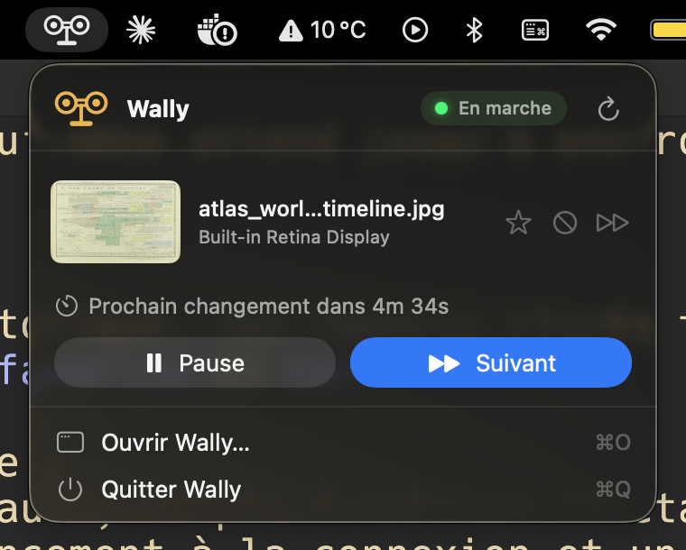

<p align="center"></p>

**Wally** rotates your wallpapers, screen by screen. A small daemon changes them at every interval; the `wally` command tells you which image is on which screen, changes them on demand and edits the settings.

macOS only for now, with a [menu bar app](#menu-bar-app) on top of the command line.

## Install

With Homebrew:

```sh
brew install slashome/tap/wally
wally init
```

After `brew upgrade wally`, run `wally daemon restart` so the daemon runs the new version.

Or with the install script:

```sh
curl -fsSL https://raw.githubusercontent.com/slashome/wally/main/install.sh | sh
```

The script downloads the latest release (or builds it with `cargo` when there is none), installs `wally` in `~/.local/bin` and runs `wally init`.

| Variable | Effect |
|---|---|
| `WALLY_INSTALL_DIR` | where to install the binary, `~/.local/bin` by default |
| `WALLY_SOURCE` | the folder of wallpapers, instead of asking (`wally init --source`) |
| `WALLY_VERSION` | a release tag, instead of the latest |
| `WALLY_NO_DAEMON=1` | install the binary only |

From source: `cargo install --git https://github.com/slashome/wally`, then `wally init`.

## Menu bar app

<p></p>

**Wally.app** drives the daemon from the menu bar:

- the image on each screen, with its name and folder;
- **Next**, for every screen or one, and **Pause** to keep the current images;
- **favorites** to see an image more often, **bans** to never see it again;
- the **library** of every image the sources hold, and the **history** of what each screen showed;
- the **settings**: sources, interval, order, one image per screen or the same everywhere, and opening Wally at login.

<p align="center"></p>

It needs the `wally` command and its daemon, which the cask installs first:

```sh
brew install --cask slashome/tap/wally-app
```

The app holds no copy of `wally`: it drives the one the formula installs, so the command and the app never disagree. When the command is missing, or its daemon is not running or too old, the app says so and shows the command to run.

The app is signed ad hoc, not notarized by Apple. On first launch macOS refuses to open it: open **System Settings › Privacy & Security**, find the message about Wally near the bottom and click **Open Anyway**, then confirm. macOS remembers the choice until the next update.

To build it from source, with the Swift toolchain of the Xcode Command Line Tools: `app/scripts/bundle.sh` writes `app/build/Wally.app`, a universal binary signed ad hoc; `--zip` also packs `app/build/Wally-<version>.zip`.

## Commands

| Command | |
|---|---|
| `wally init` | set wally up: it looks at this Mac first, then asks only what it cannot guess (`--yes`, `--source`, `--no-daemon`) |
| `wally status` | whether the daemon runs, the sources and their image count, when the next change comes |
| `wally show` | which image is on which screen, left to right (`--paths`, `--json`); alias `current` |
| `wally next` | change now, every screen or one (`--screen 2`, `--screen dell`); alias `change` |
| `wally pause`, `wally resume` | stop the scheduled changes and keep the current images, then start again |
| `wally set <image>` | put this image on a screen (`--screen`) |
| `wally favorite [image]`, `wally ban [image]` | show an image more often, or never again; the image on screen by default (`--screen`, `--off`) |
| `wally history` | the images shown lately, newest first (`--limit`, `--paths`, `--json`) |
| `wally search <words>` | images whose file name contains every word (`--paths`, `--json`, `--regex`, `--deep`) |
| `wally settings` | print the configuration; `get`, `set`, `edit`, `path`, `source add\|remove` |
| `wally daemon` | `install`, `uninstall`, `start`, `stop`, `restart` |
| `wally help [command]` | the help, the banner included |

```console
$ wally show
1  DELL U2723QE             arne-forest.jpg
2  Built-in Retina Display  dune-night.webp
```

## Setting up

```console
$ wally init
Detected
  system     macOS 26.4.1, aarch64
  screens    1: Built-in Retina Display
  wallpaper  ~/Pictures/Wallpapers/arne-forest.jpg
  config     none yet
  daemon     not installed

Where are your wallpapers?
  1) ~/Pictures/Wallpapers  412 images (+32 in subfolders), holds the image on screen
  0) another folder
Folders, by number [1]:
Include the 32 images of their subfolders? [y/N]:
Change every [30m]: 15m
Order: random or sequential [random]:
Change them on schedule, starting at login? [Y/n]:
```

It offers the folders it finds — the one a screen shows, the one macOS rotates, those named like wallpapers in Pictures, Documents and iCloud Drive — and asks about subfolders, one image per screen or starting at login only when it matters. Run it again to review everything: the current configuration gives the defaults.

## Configuration

`~/.config/wally/config.yaml`, created on first run. The daemon follows every change, no restart needed.

```yaml
sources:
- ~/Pictures/Wallpapers
recursive: false     # walk subfolders too
interval: 30m        # 45s, 30m, 1h 30m… at least 10s
order: random        # random: every image once before any twice; or sequential
screens: distinct    # an image per screen; or same
```

```sh
wally settings source add ~/Pictures/Space
wally settings set interval 15m
wally settings edit          # $EDITOR, checked before it is saved
```

## How it works

Wally owns the rotation: the daemon draws the next images and puts them on each screen through `NSWorkspace`, so `wally show` reads the exact file from macOS — no screen capture, no guessing. A screen plugged in gets its image within seconds, without waiting for the interval.

- Setting a wallpaper this way replaces the rotating folder of System Settings with a fixed image per screen: wally becomes the one rotating them.
- macOS only sets the wallpaper of the current Space, fullscreen apps included. So the daemon puts the chosen image back on any Space that shows another one, within seconds of it coming up: every Space follows, and a wallpaper picked by hand in System Settings is replaced. Without the daemon, `wally next` only changes the current Space.
- The daemon is a LaunchAgent, `~/Library/LaunchAgents/me.slashome.wally.plist`; it logs in `~/Library/Logs/wally/wally.log` and keeps its state in `~/.local/state/wally/`.

## Uninstall

```sh
brew uninstall --cask --zap wally-app
wally daemon uninstall
rm ~/.local/bin/wally
rm -r ~/.config/wally ~/.local/state/wally ~/Library/Logs/wally
```

## Credits

The little robot of the banner, and its yellow paint going rusty, are a tribute to WALL·E (Pixar, 2008). Wally is a personal project, not affiliated with Pixar or Disney.

## License

MIT
